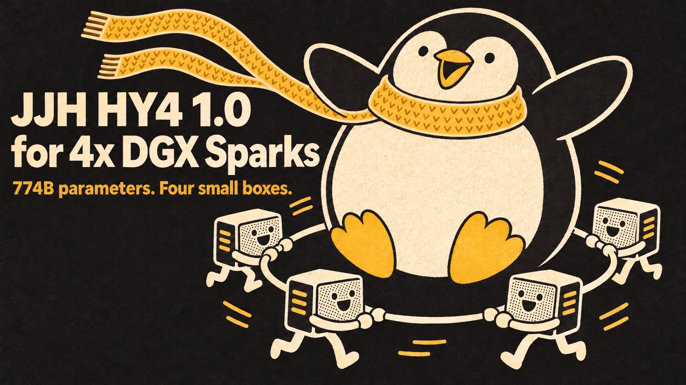

  

# JJH HY4 1.0 for 4x DGX Sparks

This is a quantized Derivative Work of the full [Tencent Hy4](https://huggingface.co/tencent/Hy4/tree/c10c0de5) checkpoint at `c10c0de5`. We changed the routed expert weights to EXL3 `mul1`, added packed copies of the attention and shared-expert weights (the trunk) beside the source ones, and repacked the checkpoint for the text runtime. The vision tower is not in the pack: it ships as a separate folder, `vit-bf16/`, its 649 tensors copied unchanged in BF16.

Version 1.0 of this recipe. Its receipts are in the [recipe's repository](https://github.com/jakejharris/jjh-hy4-dgx-spark) under `receipts/`.

It runs in two configurations from the same files:

- **Full quant (default).** Routed experts and trunk both packed. Its output differs from the lossless trunk configuration.
- **Lossless trunk (option).** The same routed experts; the trunk and the KV cache stay at source precision.

## What to expect

The full quant on four DGX Sparks, each graphics clock capped at 2,200 MHz, drafts on, thinking off. Measured on the recipe's engine before its sampling fix (`ef8ebb7c`); on the fixed build the recipe ships, greedy requests gave the same tokens. Setups are in the [README](https://github.com/jakejharris/jjh-hy4-dgx-spark#reading-the-numbers).

| Default launch | tok/s |
| --- | --- |
| Cold prefill, one request at 8K / 32K / 64K | 467.72 / 444.41 / 420.89 |
| One-stream decode, median of 3: code / prose / structured | 37.69 / 19.07 / 54.58 |

## Size

Read from the weight files' headers on a Spark that holds the full pack.

| Build | Text model | Bits per weight |
| --- | --- | --- |
| Full quant (`4b6b`, default) | 300.07 GB | 3.12 |
| Lossless trunk | 331.69 GB | 3.45 |
| Every weight in BF16 | 1,539.81 GB | 16.00 |

The text model is every tensor in the weight index except the DFly2 drafter's. Its size counts tensor data, not file headers, and bits per weight is that size in bits over its weights, each packed matrix counted at its full shape. The BF16 row is 2 bytes a weight, not the size of Tencent's files. GB is 10^9 bytes. Script and output: the recipe's `tools/text_size.py` and `receipts/quant/text_size.json`.

Served, the full quant reads 300.07 GB of text weights, plus its drafter and, with vision on, `vit-bf16/` (2.47 GB) on rank 0. The download is 371.84 GB (346.31 GiB) because one folder holds both builds: the source trunk and both packed trunks. Cut into parts, each Spark holds 79.74 GB: its own 75.69 GB and 4.05 GB that all four keep.

## Allocation

| Weight group | Full quant (default) | Lossless trunk |
| --- | --- | --- |
| Routed experts, layers 1 to 19 and 77 | EXL3 mul1, 3.00 bits per weight requested (`-b 3`) | same |
| Routed experts, layers 20 to 76 | EXL3 mul1 · 3.00 bpw in the frozen recipe | same |
| Routed Hadamard scales | FP16 with an `i32` marker (`--out_scales always`) | same |
| Attention | EXL3 mul1 · `4b6b` | BF16, `sinks` FP32 |
| Shared experts | EXL3 mul1 · `4b6b`, except `down_proj` at layers 75 and 76, kept BF16 | BF16 |
| Dense input layer | BF16 | same |
| Embeddings and LM head | Embeddings BF16; LM head stored at 16 bits, FP32 at load | same |
| Token indexer | `wq_b` and `wk` BF16; `k_norm` and `weights_proj` FP32 | same |
| iHC, routers and norms | iHC and `e_score_correction_bias` FP32; routers and norms BF16 | same |
| KV cache and token index | BF16 | BF16 |
| DFly2 drafter | 4-bit EXL3 copy, served by default; source weights BF16 | same |
| Vision tower and adapter | Not in the pack: the separate folder `vit-bf16/`, BF16, copied unchanged; read on rank 0 when vision is on | same |

Apart from the trunk width and the middle-layer bits, the rows are the recipe's settings (the recipe's `quant/README.md`), not sizes read back from the finished files. `4b` packs every trunk matrix at 4 bits, `4b6b` keeps `o_proj` and `kv_a` at 6 bits, and `6b` packs everything at 6 bits.

The shared-expert `down_proj` input overflows FP16 at layers 75 and 76 on ordinary tokens, so those two matrices stay BF16 in every configuration. The recipes record the frozen calibration inputs, per-projection bit choices, output-scale policy, and resume and compile steps. The finished pack, both builds, is 346.31 GiB on disk in 251 files (`SHA256SUMS` lists them).

## Run it

Use [jakejharris/jjh-hy4-dgx-spark](https://github.com/jakejharris/jjh-hy4-dgx-spark) for the pinned build, weight verification, ring configuration, launch command, and benchmark settings. The TensorFold recipe targets four NVIDIA DGX Sparks on a direct RoCE cable ring, with local SSD space for the weights and memory headroom for the BF16 KV and index cache.

The full quant is the default launch; one overlay file selects the lossless trunk. Check the download against the published weight manifest, `SHA256SUMS` (run `sha256sum -c SHA256SUMS` in the weights folder; the recipe holds the same file as `launch/weights.sha256`), then follow the recipe's preflight and launch steps.

Thinking is on by default. On one long coding task, greedy with thinking on, the reasoning used the whole 8,192-token reply before any answer started. At `temperature` 0 the task finished with `"thinking_budget"` 4096 or with `reasoning_effort` `no_think`.

Sampled at 0.9, Tencent's own default, or at 0.7, the recipe's launcher default for a request that sends no `temperature`, it did not finish, with the budget or without it. Other temperatures and tasks are not measured yet (the recipe's `FINDINGS.md`, finding 6).

## Fidelity and limits

| Measure | Full quant (default) | Lossless trunk |
| --- | --- | --- |
| Top-1 agreement with the BF16 reference, familiar set | 96.73% (spread: prose 97.22%, code 96.35%; 336 positions) | 97.02% (spread: prose 97.22%, code 96.88%; 336 positions) |
| Top-1, full quant minus lossless trunk, familiar set | -0.30 points (spread: 1 position only the lossless build gets right, 0 only the full quant) | Not applicable |
| Familiar set: the reference's own next-token accuracy; close calls | 91.04% (prose 92.15%, code 90.21%); 6.38% of positions | same set |
| Top-1 agreement with the BF16 reference, fresh set | 91.41% (spread: prose 89.58%, code 93.23%; 384 positions) | 90.10% (spread: prose 87.50%, code 92.71%; 384 positions) |
| Top-1, full quant minus lossless trunk, fresh set | +1.30 points (spread: 3 positions only the lossless build gets right, 8 only the full quant) | Not applicable |
| Fresh set: the reference's own next-token accuracy; close calls | 65.44% (prose 54.94%, code 75.94%); 17.23% of positions | same set |

These compare the served greedy next token with the reference's (Tencent's checkpoint, BF16 weights, FP32 head) at the same positions for both configurations, on public sets of 384-token prose and code excerpts whose sources and licenses are listed in the recipe (`eval/prefixes/`). The familiar set is widely copied documentation and source code; the fresh set is text first published in November 2026.

The third row is there because a set the model has memorized makes every build look alike: on the familiar set the reference itself predicts the published next token at 91.04% of positions, and only 6.38% of positions are close calls (top-two logit gap under 0.5).

On the fresh set the reference predicts 54.94% of prose and 75.94% of code positions, with 17.23% close calls: new text, with 2.7 times the close calls, where a small rounding change can flip a pick, so the fresh rows are the ones that tell builds apart. Anyone with the recipe can rerun them.

The [quality card](https://github.com/jakejharris/jjh-hy4-dgx-spark/blob/main/card/QUALITY_CARD.md) gives the setup, the paired counts behind both differences, and speed and memory for both configurations. Top-1 agreement measures greedy next-token choice on those prefixes, not full distributions. Treat a tested retrieval depth separately from general long-context reasoning.

Vision is off unless the launch asks for it (`SERVE_VISION=1` with the `vit-bf16/` folder on rank 0). It reads still images only, and its accuracy was checked on three images and three screenshots, not on a benchmark.

Prefill in this recipe takes a faster path, on by default. The recipe's launch setting `TF_HY4_FAST_PREFILL=0` turns it off. The two paths round differently, so the same prompt and seed can give a different answer on each.

With drafts on, every token is still the full model's own greedy pick, but it is checked in a wider batch, and BF16 rounds differently at another batch width. At a close call the pick can go the other way, and the text after it is a different continuation, so drafted output is not the same text as plain output; the quality card gives the measured counts.

The launch files turn on the repeat option (`TF_HY4_REPEAT_STABLE=1`), so with drafts on a repeat of the same prompt gives the same tokens; `TF_HY4_REPEAT_STABLE="0"` turns it off, and then a repeat can differ.

## License and notices

Tencent Hy License, Version 1.0 applies to these weights. See the full [LICENSE](https://huggingface.co/jakejharris/jjh-hy4-exl3/blob/main/LICENSE). `tencent/Hy4` ships no NOTICE file. Our [NOTICE](https://huggingface.co/jakejharris/jjh-hy4-exl3/blob/main/NOTICE), beside the weights, carries the Appendix notice with the release copyright holder and year, and the change notice: it names every file we changed or added and says what changed. Tencent's name identifies their origin. The license supplies the warranty and liability terms.

The change notice in short: we changed or added 242 of the 251 files, all from `tencent/Hy4` revision `c10c0de5`. The `.safetensors` files are not altered to carry the notice, so the 238 we changed keep the SHA-256 sums verified on all four Sparks (`SHA256SUMS`).

- `model.layers.N.safetensors`, N = 0 to 77 (78 files): new, one per decoder layer. Layers 1 to 77 have their routed experts re-encoded as EXL3 at 3.00 bits; every other tensor is copied.
- `trunk-4b/` and `trunk-6b/` (80 `.safetensors` files and a `trunk.index.json` each): new. The attention and shared-expert weights, the output head and the DFly2 drafter, packed as EXL3 at 4 and at 6 bits.
- `config.json` and `model.safetensors.index.json`: changed for the quantized pack.
- Not changed: four `tencent/Hy4` weight shards (`model-00053`, `-00061`, `-00124` and `-00245-of-00245.safetensors`) and the tokenizer, chat template, generation and processor files.

The vision folder, `vit-bf16/`, is three more files from the same revision, listed in its own `SHA256SUMS`:

- `vit.safetensors`: new. The 649 `vit.*` tensors of the vision tower and its adapter, copied unchanged in BF16 from eight source shards into one file.
- `config.json` and `processor_config.json`: Tencent's files, not changed.

Section 10 remains in force. Model-as-a-service operators need a separate written license from Tencent before use or continued use if aggregate worldwide gross revenue from all sources exceeds US$50 million in any consecutive 12 months. A separate license is also required before use in or for an operator's product or service with more than 100 million monthly active users in any calendar month. Solely internal use is exempt under Section 10.3 while the model, derivatives, and outputs are all withheld from third parties. The license defines covered services in Section 10.1 and gives the licensor contact in Section 10.4.
